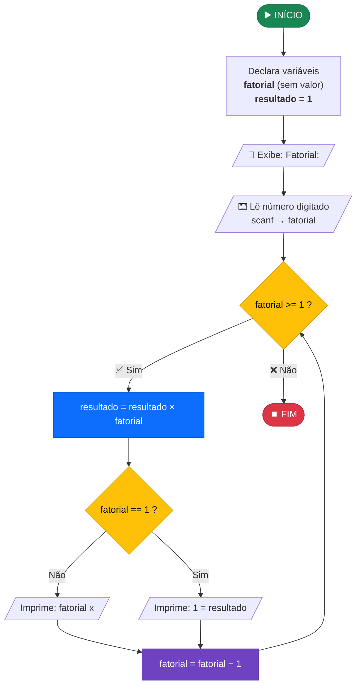
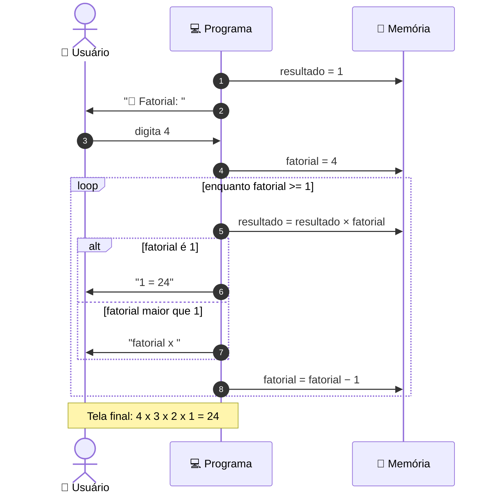

<div align="center">

# 🧮 Calculadora de Fatorial em C

**Programa de linha de comando que calcula o fatorial de um número inteiro e mostra cada multiplicação na tela**


-2ea44f?style=for-the-badge)

```
  ┌───────────────────────────────────────────────┐
  │  📌 Fatorial: 5                               │
  │  5 x 4 x 3 x 2 x 1 = 120                      │
  └───────────────────────────────────────────────┘
```

</div>

---

## 📑 Sumário

1. [Visão geral](#-visão-geral)
2. [O que é fatorial](#-o-que-é-fatorial)
3. [Estrutura do projeto](#-estrutura-do-projeto)
4. [Como compilar e executar](#-como-compilar-e-executar)
5. [Fluxo de funcionamento](#-fluxo-de-funcionamento)
6. [O código, bloco por bloco](#-o-código-bloco-por-bloco)
7. [Teste de mesa (passo a passo)](#-teste-de-mesa-passo-a-passo)
8. [Visualização da memória](#-visualização-da-memória)
9. [Exemplos de execução](#-exemplos-de-execução)
10. [Casos limite e limitações](#-casos-limite-e-limitações)
11. [Análise de complexidade](#-análise-de-complexidade)
12. [Possíveis melhorias](#-possíveis-melhorias)

---

## 🎯 Visão geral

O programa pede um número ao usuário, calcula o fatorial dele com um laço `while` **decrescente** e imprime a expressão completa da multiplicação junto com o resultado.

| Item | Descrição |
|---|---|
| **Entrada** | Um número inteiro digitado pelo usuário |
| **Processamento** | Multiplicações sucessivas de `n` até `1` |
| **Saída** | A expressão `n x (n-1) x ... x 1 = resultado` |
| **Estrutura principal** | Laço `while` com uma decisão `if/else` dentro |

---

## 📐 O que é fatorial

O fatorial de um número `n` (escrito **n!**) é o produto de todos os inteiros positivos de `1` até `n`:

```
n! = n × (n − 1) × (n − 2) × … × 2 × 1
```

| n | Expressão | n! |
|:-:|:--|--:|
| 1 | `1` | 1 |
| 2 | `2 × 1` | 2 |
| 3 | `3 × 2 × 1` | 6 |
| 4 | `4 × 3 × 2 × 1` | 24 |
| 5 | `5 × 4 × 3 × 2 × 1` | 120 |
| 6 | `6 × 5 × 4 × 3 × 2 × 1` | 720 |

> 💡 Por definição matemática, **0! = 1**.

---

## 📁 Estrutura do projeto

```
Fatorial/
├── 📄 fatorial.c      → código-fonte do programa
├── ⚙️ fatorial.exe    → executável gerado pelo GCC (Windows)
├── 📝 runner.txt      → comando usado para compilar e executar
└── 📘 README.md       → esta documentação
```

---

## 🚀 Como compilar e executar

### Pré-requisitos

- Compilador **GCC** instalado (no Windows, via [MinGW-w64](https://www.mingw-w64.org/) ou [MSYS2](https://www.msys2.org/))
- Terminal **PowerShell**

### Comando único (o mesmo do `runner.txt`)

```powershell
clear; chcp 65001; gcc.exe fatorial.c -o fatorial.exe; .\fatorial.exe;
```

### O que cada parte faz


| Comando | Função |
|---|---|
| `clear` | Limpa o terminal antes de começar |
| `chcp 65001` | Muda a página de código do console para **UTF-8**. Sem isso, o emoji 📌 aparece como caracteres estranhos no Windows |
| `gcc.exe fatorial.c -o fatorial.exe` | Compila o código-fonte e gera o executável |
| `.\fatorial.exe` | Roda o programa |

### Linux / macOS

```bash
gcc fatorial.c -o fatorial && ./fatorial
```

---

## 🔄 Fluxo de funcionamento

### Fluxograma completo



### As três fases do programa

```
╔════════════════════╗     ╔══════════════════════════════╗     ╔════════════════════╗
║   1. ENTRADA       ║     ║   2. PROCESSAMENTO (laço)    ║     ║   3. SAÍDA         ║
║────────────────────║     ║──────────────────────────────║     ║────────────────────║
║ • printf pergunta  ║ ──▶ ║ • multiplica o acumulador    ║ ──▶ ║ • última volta     ║
║ • scanf lê o n     ║     ║ • imprime "n x "             ║     ║   imprime "= total"║
║                    ║     ║ • decrementa n               ║     ║ • programa termina ║
╚════════════════════╝     ╚══════════════════════════════╝     ╚════════════════════╝
```

### Interação usuário ↔ programa



---

## 🔍 O código, bloco por bloco

### 1️⃣ Bibliotecas

```c
#include<stdio.h>    // ✅ usada: printf e scanf
#include<stdlib.h>   // ⚪ não utilizada
#include<string.h>   // ⚪ não utilizada
#include<math.h>     // ⚪ não utilizada
```

Só a `stdio.h` é necessária. As outras três podem ser removidas sem afetar o programa.

### 2️⃣ Declaração das variáveis

```c
int fatorial;        // número digitado; também serve de contador do laço
int resultado = 1;   // acumulador do produto
```

> 🔑 **Por que `resultado` começa em 1?**
> Porque 1 é o **elemento neutro da multiplicação**. Se começasse em 0, todo produto daria 0.

```
 resultado = 0  →  0 × 5 × 4 × 3 × 2 × 1 = 0    ❌
 resultado = 1  →  1 × 5 × 4 × 3 × 2 × 1 = 120  ✅
```

### 3️⃣ Entrada de dados

```c
printf("📌 Fatorial: ");
scanf("%d",&fatorial);
```

- `printf` mostra a mensagem para o usuário.
- `scanf("%d", &fatorial)` lê um inteiro (`%d`) e guarda no **endereço** da variável (`&fatorial`).

### 4️⃣ O laço principal

```c
while(fatorial >= 1)                       // ← repete enquanto houver números a multiplicar
{
    resultado = resultado * fatorial;      // ← ① acumula o produto

    if(fatorial == 1)                      // ← ② é a última volta?
    {
        printf("%d = %d",fatorial,resultado);   //   sim → imprime "1 = total"
    }
    else
    {
        printf("%d x ",fatorial);               //   não → imprime "n x "
    }
    fatorial = fatorial - 1;               // ← ③ avança para o próximo número
}
```

Cada volta do laço faz **três coisas, sempre nesta ordem**:

```
   ┌──────────────┐      ┌──────────────────┐      ┌──────────────┐
   │ ① MULTIPLICA │ ───▶ │ ② IMPRIME        │ ───▶ │ ③ DECREMENTA │ ──┐
   │ resultado *= │      │ "n x " ou        │      │ fatorial--   │   │
   │   fatorial   │      │ "1 = total"      │      │              │   │
   └──────────────┘      └──────────────────┘      └──────────────┘   │
          ▲                                                           │
          └──────────────── volta enquanto fatorial >= 1 ─────────────┘
```

> 💡 A variável `fatorial` tem **dupla função**: guarda o número digitado e também serve de contador regressivo do laço. Por isso, ao final, o valor original se perde (fica `0`).

---

## 📋 Teste de mesa (passo a passo)

Simulação completa com a entrada **`5`**:

| Volta | `fatorial` (antes) | Condição `>= 1` | Cálculo | `resultado` | `fatorial == 1`? | Impresso na tela | `fatorial` (depois) |
|:-:|:-:|:-:|:--|:-:|:-:|:--|:-:|
| — | 5 | — | *valor inicial* | 1 | — | `📌 Fatorial: ` | 5 |
| 1 | 5 | ✅ | `1 × 5` | **5** | ❌ | `5 x ` | 4 |
| 2 | 4 | ✅ | `5 × 4` | **20** | ❌ | `4 x ` | 3 |
| 3 | 3 | ✅ | `20 × 3` | **60** | ❌ | `3 x ` | 2 |
| 4 | 2 | ✅ | `60 × 2` | **120** | ❌ | `2 x ` | 1 |
| 5 | 1 | ✅ | `120 × 1` | **120** | ✅ | `1 = 120` | 0 |
| — | 0 | ❌ | *sai do laço* | 120 | — | — | 0 |

### Como a linha de saída é montada

```
Volta 1:  5 x
Volta 2:  5 x 4 x
Volta 3:  5 x 4 x 3 x
Volta 4:  5 x 4 x 3 x 2 x
Volta 5:  5 x 4 x 3 x 2 x 1 = 120   ← linha completa
```

### Crescimento do acumulador

```
Volta 1 │ ██                                          5
Volta 2 │ ███████                                    20
Volta 3 │ ████████████████████                       60
Volta 4 │ ████████████████████████████████████████  120
Volta 5 │ ████████████████████████████████████████  120  (× 1 não altera)
        └──────────────────────────────────────────
```

---

## 🧠 Visualização da memória

Estado das duas variáveis durante a execução com entrada `5`:

```
                 fatorial      resultado
               ┌──────────┐  ┌──────────┐
 Após scanf    │    5     │  │    1     │
               ├──────────┤  ├──────────┤
 Fim volta 1   │    4     │  │    5     │
               ├──────────┤  ├──────────┤
 Fim volta 2   │    3     │  │   20     │
               ├──────────┤  ├──────────┤
 Fim volta 3   │    2     │  │   60     │
               ├──────────┤  ├──────────┤
 Fim volta 4   │    1     │  │  120     │
               ├──────────┤  ├──────────┤
 Fim volta 5   │    0     │  │  120     │  ← condição falha, laço encerra
               └──────────┘  └──────────┘
```


---

## 💻 Exemplos de execução

Saídas reais do programa compilado:

```console
📌 Fatorial: 1
1 = 1
```

```console
📌 Fatorial: 3
3 x 2 x 1 = 6
```

```console
📌 Fatorial: 5
5 x 4 x 3 x 2 x 1 = 120
```

```console
📌 Fatorial: 12
12 x 11 x 10 x 9 x 8 x 7 x 6 x 5 x 4 x 3 x 2 x 1 = 479001600
```

---

## 🚨 Casos limite e limitações

| Entrada | Saída do programa | Esperado | Situação |
|:-:|:--|:--|:-:|
| `1` a `12` | Resultado correto | Resultado correto | ✅ |
| `0` | *nada é impresso* | `0! = 1` | ⚠️ |
| Negativo (ex.: `-3`) | *nada é impresso* | Mensagem de erro | ⚠️ |
| `13` ou mais | Valor **errado** | Valor real | ❌ |
| Letra (ex.: `a`) | *nada é impresso* (comportamento indefinido) | Mensagem de erro | ❌ |

### 🔴 Estouro de inteiro (overflow) a partir de 13!

Um `int` de 32 bits guarda no máximo **2.147.483.647**. O fatorial de 13 passa desse limite:

```
 Limite do int:   2.147.483.647
 12!          :     479.001.600   ✅ cabe
 13!  (real)  :   6.227.020.800   ❌ não cabe
 13!  (impresso): 1.932.053.504   ← valor errado, "deu a volta"
```


### 🟡 Entrada 0 ou negativa

Como a condição é `fatorial >= 1`, o laço **nunca executa** e o programa termina sem mostrar resultado, embora matematicamente `0! = 1`.

---

## 📊 Análise de complexidade

| Métrica | Valor | Explicação |
|---|:-:|---|
| **Tempo** | `O(n)` | O laço executa exatamente `n` vezes |
| **Espaço** | `O(1)` | Usa apenas duas variáveis, independentemente de `n` |
| **Multiplicações** | `n` | Uma por volta |
| **Chamadas a `printf`** | `n + 1` | Uma da pergunta + uma por volta |

---

## 🛠️ Possíveis melhorias

| # | Melhoria | Benefício |
|:-:|---|---|
| 1 | Trocar `int` por `unsigned long long` | Calcula corretamente até **20!** (2.432.902.008.176.640.000) |
| 2 | Tratar `0` mostrando `0! = 1` | Respeita a definição matemática |
| 3 | Validar números negativos | Mostra mensagem de erro amigável |
| 4 | Verificar o retorno do `scanf` | Evita comportamento indefinido com letras |
| 5 | Remover `stdlib.h`, `string.h` e `math.h` | Código mais limpo |
| 6 | Adicionar `return 0;` e `\n` no final | Boa prática e terminal mais organizado |

<details>
<summary><b>👉 Clique para ver uma versão com as melhorias aplicadas</b></summary>

```c
#include <stdio.h>

int main(void)
{
    int n;
    unsigned long long resultado = 1;

    printf("📌 Fatorial: ");

    if (scanf("%d", &n) != 1) {
        printf("❌ Entrada inválida. Digite um número inteiro.\n");
        return 1;
    }

    if (n < 0) {
        printf("❌ Não existe fatorial de número negativo.\n");
        return 1;
    }

    if (n > 20) {
        printf("❌ O maior valor suportado é 20.\n");
        return 1;
    }

    if (n == 0) {
        printf("0! = 1\n");
        return 0;
    }

    for (int i = n; i >= 1; i--) {
        resultado *= i;
        if (i == 1)
            printf("%d = %llu\n", i, resultado);
        else
            printf("%d x ", i);
    }

    return 0;
}
```

</details>

---

<div align="center">

**Feito em C para estudo de laços de repetição e estruturas condicionais** 📚

</div>